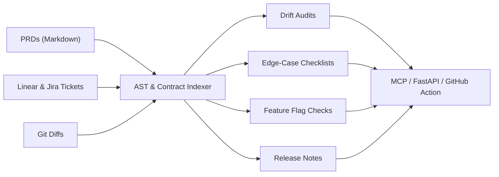

# PMCursor

[](https://github.com/creova-gif/pmcursor/actions/workflows/ci.yml)
[](LICENSE)
[](CHANGELOG.md)
[](https://www.python.org/downloads/)

PMCursor checks product requirements documents against repositories. It indexes Pydantic models, Zod schemas, Prisma schemas (`.prisma`), GraphQL schemas (`.graphql`/`.gql`), FastAPI routes, Next.js App Router routes, OpenAPI specs, SQL DDL tables, and architecture decision records. It also indexes telemetry events for PostHog, Vercel Analytics, Langfuse, and BigQuery, then flags contract drift and fabricated `file:line` citations.



## Architecture and adapted patterns

PMCursor adapts plugin packaging and CLI conventions from [`cursor/plugins`](https://github.com/cursor/plugins) and workflow gates from [`garrytan/gstack`](https://github.com/garrytan/gstack).

| Source | Upstream file | PMCursor file |
|:---|:---|:---|
| `cursor/plugins` | `schemas/plugin.schema.json` and `scripts/validate-plugins.mjs` | [.cursor-plugin/plugin.json](.cursor-plugin/plugin.json), [.claude-plugin/plugin.json](.claude-plugin/plugin.json), and [src/pmcursor/plugin_validator.py](src/pmcursor/plugin_validator.py) |
| `cursor/plugins` | `cli-for-agent/skills/cli-for-agents/SKILL.md` | [src/pmcursor/cli.py](src/pmcursor/cli.py) |
| `cursor/plugins` | `agent-compatibility/README.md` | `SpecAlignmentScore` in [src/pmcursor/drift.py](src/pmcursor/drift.py) |
| `garrytan/gstack` | `office-hours/SKILL.md` | [skills/pm-office-hours/SKILL.md](skills/pm-office-hours/SKILL.md) |
| `garrytan/gstack` | `spec/SKILL.md` | [skills/pm-spec/SKILL.md](skills/pm-spec/SKILL.md) |
| `garrytan/gstack` | `review/SKILL.md` and `ship/SKILL.md` | [skills/pm-drift/SKILL.md](skills/pm-drift/SKILL.md) and [skills/pm-ship-readiness/SKILL.md](skills/pm-ship-readiness/SKILL.md) |

## Run the CLI

1. Index repository contracts into JSON.
	```bash
	PYTHONPATH=src python3 -m pmcursor.cli index --repo . --json
	```
2. Audit a PRD for schema, route, and telemetry drift plus fabricated `file:line` citations (pass `--sarif` for SARIF 2.1.0 output compatible with GitHub Code Scanning).
	```bash
	PYTHONPATH=src python3 -m pmcursor.cli drift --prd PROJECT_SPEC.md --repo . --md
	```
3. Repair shifted `file:line` citations and mismatched field types in a PRD. Pass `--write` to apply changes.
	```bash
	PYTHONPATH=src python3 -m pmcursor.cli fix-prd --prd PROJECT_SPEC.md --repo . --dry-run
	```
4. Map a git diff to impacted contracts and PRD references.
	```bash
	PYTHONPATH=src python3 -m pmcursor.cli pr-impact --prd PROJECT_SPEC.md --repo . --base main
	```
5. Generate an interactive split-pane HTML spec canvas (supports an optional `EdgeCaseChecklist` inspector pane in `web/canvas.py`, with WCAG 2.1 AA landmarks, skip-to-workspace navigation, `:focus-visible` rings, and live filter announcements).
	```bash
	PYTHONPATH=src python3 -m pmcursor.cli canvas --prd PROJECT_SPEC.md --repo . --output canvas.html
	```
6. Validate the Cursor and Claude plugin manifests.
	```bash
	PYTHONPATH=src python3 -m pmcursor.cli validate-plugin --repo .
	```
7. Run the evaluation benchmark.
	```bash
	PYTHONPATH=src python3 -m pmcursor.cli eval --json
	```
8. Audit a Linear or Jira ticket against repository contracts.
	```bash
	PYTHONPATH=src python3 -m pmcursor.cli ticket-sync --id ENG-42 --title "Add auth" --body-file ticket.md --repo .
	```
9. Generate a codebase-cited edge-case checklist from repository contracts and an optional PRD.
	```bash
	PYTHONPATH=src python3 -m pmcursor.cli checklist --repo . --prd PROJECT_SPEC.md
	```
10. Start the FastAPI server locally (requires `pmcursor[server]`).
	```bash
	PYTHONPATH=src python3 -m pmcursor.cli serve --host 127.0.0.1 --port 8000
	```
11. Synthesize diff-grounded release notes and a PRD scope coverage matrix.
	```bash
	PYTHONPATH=src python3 -m pmcursor.cli release-notes --prd PROJECT_SPEC.md --repo . --base main --version v0.1.0
	```
12. Start the MCP server for Cursor/Claude MCP integration (configured via [.mcp.json](.mcp.json)), exposing 7 tools (`pmcursor_index`, `pmcursor_drift`, `pmcursor_checklist`, `pmcursor_ticket_sync`, `pmcursor_release_notes`, `pmcursor_flags`, `pmcursor_telemetry_verify`).
	```bash
	PYTHONPATH=src python3 -m pmcursor.cli mcp
	```
13. Extract feature flags or audit PRD flag & rollback coverage against a repository.
	```bash
	PYTHONPATH=src python3 -m pmcursor.cli flags --repo . --prd PROJECT_SPEC.md
	```
14. Index and merge contracts across multiple repositories into a unified federated `RepoMap` (optionally auditing a PRD).
	```bash
	PYTHONPATH=src python3 -m pmcursor.cli federate --repos api=./backend web=./frontend --prd PROJECT_SPEC.md
	```
15. Verify observed runtime telemetry samples (`JSON` array or `NDJSON`) against indexed `TelemetryContract` definitions.
	```bash
	PYTHONPATH=src python3 -m pmcursor.cli telemetry-verify --repo . --events-file events.json
	```
16. Compute an organization alignment summary across contracts, feature flags, drift, scope coverage, and edge-case checklists.
	```bash
	PYTHONPATH=src python3 -m pmcursor.cli dashboard --repo . --prd PROJECT_SPEC.md
	```
17. Run environment, plugin, and configuration diagnostics.
	```bash
	PYTHONPATH=src python3 -m pmcursor.cli doctor --repo .
	```
18. Publish a drift report or comment to GitHub PRs, Linear issues, or Jira issues (supports `--dry-run`).
	```bash
	PYTHONPATH=src python3 -m pmcursor.cli publish --provider github --target owner/repo#42 --body-file report.md --dry-run
	```

## FastAPI Server & GitHub Action

Install the optional server dependencies before running `serve` or starting [api/server.py](api/server.py), or build the production container image using [Dockerfile](Dockerfile) (see [docs/DEPLOYMENT.md](docs/DEPLOYMENT.md)):

```bash
pip install 'pmcursor[server]'
```

For local container development, copy [.env.example](.env.example) to `.env` and start the server with Docker Compose:

```bash
cp .env.example .env
docker compose up --build
```

### Configuration

- `PMCURSOR_API_TOKEN`: Bearer token for API authentication. Required when binding `serve` to a non-loopback host (anything other than `127.0.0.1`, `localhost`, or `::1`).
- `PMCURSOR_WEBHOOK_SECRET`: HMAC secret used to verify incoming GitHub webhook signatures.
- `PMCURSOR_LINEAR_WEBHOOK_SECRET`: HMAC-SHA256 secret used to verify incoming Linear webhook signatures (`Linear-Signature`).
- `PMCURSOR_JIRA_WEBHOOK_SECRET`: HMAC-SHA256 secret used to verify incoming Jira webhook signatures (`X-Hub-Signature`); falls back to Bearer `PMCURSOR_API_TOKEN` when unset.
- `PMCURSOR_RATE_LIMIT_PER_MIN`: Per-client request rate limit per minute (returns HTTP `429 Too Many Requests` with `Retry-After` when exceeded; `/health` and `/readyz` probes are exempt).
- `PMCURSOR_TRUST_PROXY`: Opt-in flag to resolve client IP addresses from `X-Forwarded-For` for rate limiting behind trusted reverse proxies (disabled by default).
- `PMCURSOR_CORS_ORIGINS`: Comma-separated list of allowed CORS origins for the FastAPI server (CORS middleware is disabled when unset).
- `WEB_CONCURRENCY`: Number of Uvicorn worker processes.

### Endpoints

- `GET /health`
- `GET /readyz` (readiness probe with cached repo count)
- `GET /metrics` (Prometheus-format request and repo cache metrics)
- `POST /v1/cache/clear` (clear cached repository indexes)
- `POST /v1/drift/audit`
- `POST /v1/webhooks/github`
- `POST /v1/webhooks/linear` (`Linear-Signature` HMAC-SHA256, `PMCURSOR_LINEAR_WEBHOOK_SECRET`)
- `POST /v1/webhooks/jira` (`X-Hub-Signature` HMAC-SHA256 via `PMCURSOR_JIRA_WEBHOOK_SECRET` or Bearer `PMCURSOR_API_TOKEN`)
- `POST /v1/tickets/audit`
- `POST /v1/checklist`
- `POST /v1/canvas`
- `POST /v1/release-notes`
- `POST /v1/flags/audit`
- `POST /v1/telemetry/verify`
- `POST /v1/publish` (publish comments to GitHub PRs, Linear issues, or Jira issues)
- `GET /v1/dashboard`

### Composite GitHub Action

Use [.github/actions/pmcursor-drift/action.yml](.github/actions/pmcursor-drift/action.yml) in CI workflows to run automated drift and PR impact checks on pull requests. It supports `step-summary` (default `"true"`) to write the Markdown drift report to `GITHUB_STEP_SUMMARY` and `checklist` (default `"false"`) to append a codebase-cited edge-case checklist.

## Evaluation results

Run `PYTHONPATH=src python3 -m pmcursor.cli eval --json` to execute [src/pmcursor/eval_runner.py](src/pmcursor/eval_runner.py) against the seeded FastAPI and Pydantic fixture. The fixture contains 5 contract mismatches and 2 fabricated citations.

| Metric | Target | Result |
|:---|:---|:---|
| Schema and route mismatch recall | `>= 85.0%` | `100.0%` (`5/5`) |
| Unflagged fabricated file citations | `0` | `0` (`2/2` caught) |
| Plugin manifest and component check | `VALID` | `VALID` (`6/6` files) |

## Install the plugin in Cursor

Link this repository into your local Cursor plugins folder:

```bash
mkdir -p ~/.cursor/plugins/local
ln -sfn "$(pwd)" ~/.cursor/plugins/local/pmcursor
```

## Contributing

Contributions are welcome! See [CONTRIBUTING.md](CONTRIBUTING.md) for local setup, quality gates, and the pull request workflow, and [SECURITY.md](SECURITY.md) for vulnerability reporting. PMCursor is licensed under the [MIT License](LICENSE).

## References

- [Product specification and GTM doc](https://docs.google.com/document/d/1yNfo6zNq6T2POAKWvcUkmFM7yxDONYvYq8_wYpoJuT0/edit?usp=drivesdk&ouid=110227624285917376281)
- [Portfolio strategy](https://docs.google.com/document/d/12Wpg5mMGnjnl2uhMBTOR0QqRzQj8kwfzTLpvLoRuB5Q/edit?usp=drivesdk&ouid=110227624285917376281)
- [ADR-001 on AST contract indexing](docs/adr/001-contract-first-repo-indexing.md)
- [ADR-002 on plugin and skill architecture](docs/adr/002-cursor-plugin-and-gstack-skill-architecture.md)
- [Roadmap](docs/ROADMAP.md)
- [Deployment guide](docs/DEPLOYMENT.md)
- [Security policy](SECURITY.md)
- [Engineering standards](AGENTS.md) and [threat model](docs/THREAT_MODEL.md)
